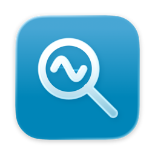
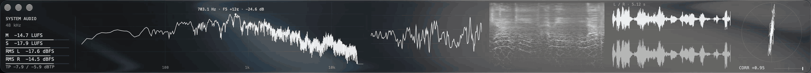

<p align="center"></p>

<h1 align="center">Audioglass</h1>

<p align="center">Native macOS audio meters on a translucent glass window.</p>



Audioglass listens to everything your Mac plays, or to a single app such as your DAW, and draws six live meters: Spectrum, Oscilloscope, Spectrogram, Waveform, Stereometer, and Loudness. The analysis comes from [OpenMeters](https://github.com/httpsworldview/openmeters); the window, controls, and rendering are native AppKit and Metal.

Everything runs on your Mac. Audioglass never records, stores, or sends audio anywhere.

## Install

Requires macOS 26 or later on Apple silicon.

1. Download `Audioglass.zip` from the [latest release](https://github.com/cillianpower/audioglass/releases/latest), unzip it, and move **Audioglass** to Applications.
2. Open it. Audioglass isn't notarized, so macOS blocks the first launch. Go to **System Settings → Privacy & Security**, scroll down, and click **Open Anyway**.
3. Allow **system audio recording** when asked. macOS may ask again after you update Audioglass.

## Meters

- **Spectrum**: FFT from 4096 to 32768 points, Mid/Side/Left/Right source with an optional second trace, linear/log/ERB frequency scale, A-weighting, smoothing, and a peak label. Hover for Hz, note, cents, and dB; click and hold to freeze.
- **Oscilloscope**: pitch-stable or zero-crossing trigger, one or two channels overlaid or stacked, 10–100 ms capture, and persistence trails.
- **Spectrogram**: sharpened time-frequency reassignment or classic FFT, with controls for FFT size, hop, window, zero padding, frequency scale, floor, spectral tilt, scroll or waterfall orientation, and a glass or heat palette.
- **Waveform**: scrolling min/max history of any channel, with an optional second lane and RMS envelope.
- **Stereometer**: Lissajous or dot cloud, linear or scaled radial view, three rotations, and full-band or low/mid/high correlation.
- **Loudness**: momentary and short-term LUFS, RMS, true peak with optional hold, and a clip indicator.

Oscilloscope, Waveform, and Stereometer can scale quiet audio to fill the view. Readouts and correlation always use the actual levels.

## Use

- **Audio Source** menu: choose System Audio or a single running app. Audio interfaces and microphones are listed too, but have had less testing.
- **Settings (⌘,)**: show, hide, and reorder meters, and change every per-meter option. The same options are under **View**, in a submenu for each meter.
- **Layout**: Automatic (⌘1) picks a wide strip or a tall column from the window's shape; Horizontal (⌘2) and Vertical (⌘3) fix it. In a strip, source and loudness sit on the left; in a column, they run across the top. **Window → Meter Strip / Meter Column** resize to presets.
- **Resize meters**: hold Shift and drag the divider between two meters. **View → Reset Section Sizes** evens them out.
- **Hover** any graph for readouts. In a strip, meter names appear in the hover card to leave more room for the plots.
- **Loudness**: click the readings to clear held peaks and the CLIP badge, or drag them to move the window.
- **View → Reset Analysis (⌘R)** restarts capture and clears history. **View → Frame Rate** chooses 60 or 120 fps (120 by default, limited by your display).

Audioglass remembers its window, layout, meter sizes, source, and settings between launches.

## Build from source

Requires macOS 26+, Xcode 26 (Swift 6.2+), and Rust 1.94+.

```sh
zsh scripts/build-app.sh
open build/Audioglass.app
```

Run the tests with:

```sh
cargo test --manifest-path Rust/Cargo.toml
zsh scripts/test-transport.sh
```

[docs/ARCHITECTURE.md](docs/ARCHITECTURE.md) explains how capture, analysis, and rendering fit together.

## Roadmap

Next up: more per-meter controls, spectrogram frequency labels and zoom, and possibly separate meter windows. VU meters, recording, plug-ins, and presets are out of scope.

## License and credits

Audioglass is free software under the [GNU General Public License v3.0 or later](LICENSE).

The audio analysis in `Rust/src/` is adapted from [OpenMeters](https://github.com/httpsworldview/openmeters) 1.15.2 by Maika Namuo, also GPL-3.0-or-later. [Rust/UPSTREAM.md](Rust/UPSTREAM.md) records the pinned upstream commit and every change made to it.
